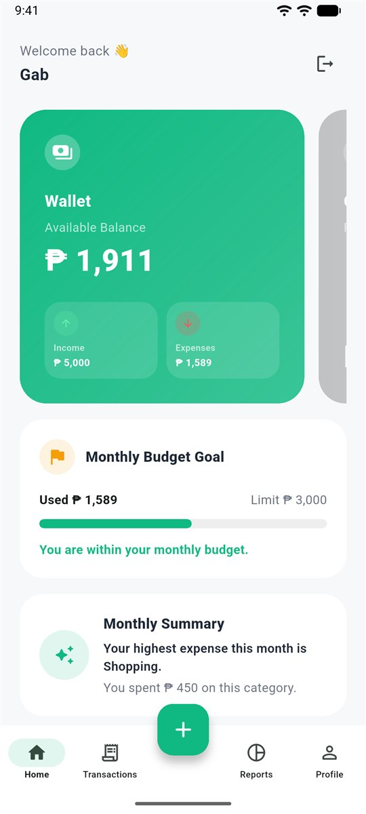
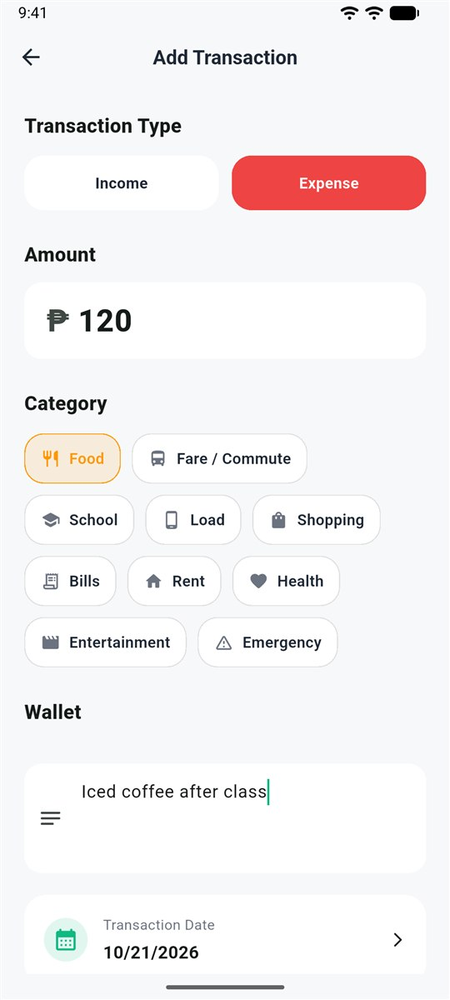
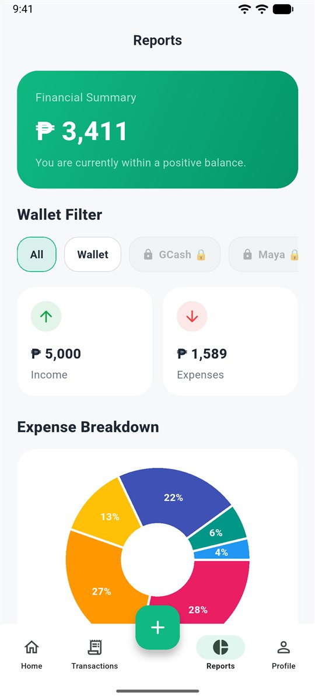
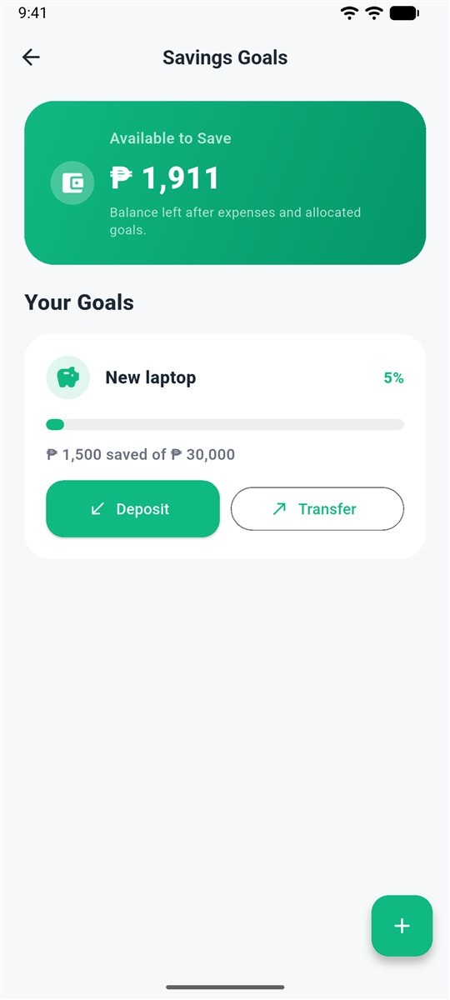

# SpendSmart

A budget and expense tracker for Filipino students and young professionals. Record income and expenses in pesos, set a monthly budget, save toward goals, and see where your money goes.

<p>
  
  
  
  
</p>

## Features

- **Dashboard:** wallet balance, income, and expenses, plus a monthly summary that points out your biggest spending category
- **Transactions:** income and expenses with category, wallet, date, and note; a full history you can filter by wallet, edit, or delete
- **Categories made for local life:** Fare / Commute, Load, School, Allowance, and more, plus custom categories with your own icon and color
- **Monthly budget goal** that tells you when you're within, close to, or over your limit
- **Savings goals** with deposits and transfers, limited to the money you actually have left after expenses
- **Reports:** a pie chart of expenses by category and an income vs. expenses summary
- **Accounts:** onboarding, sign-up as a student or young professional, login, and an editable profile

The free plan includes a cash wallet. GCash, Maya, BPI, and BDO wallets and the Plus / Premium plans are shown as a prototype upgrade screen; payments are not implemented.

## Tech stack

- **Flutter** and **Dart** (Android)
- **Firebase Authentication** for accounts
- **Cloud Firestore** for all user data, stored under each user's own document
- **fl_chart** for the expense breakdown chart

## Project structure

```
lib/
├── main.dart              App entry and auth wrapper
├── firebase_options.dart  Firebase configuration
├── data/                  Default categories
├── models/                Transaction, wallet, category, budget, and savings goal models
├── services/              Firestore and auth services
├── screens/               Dashboard, transactions, reports, savings goals, profile, and more
└── theme/                 Colors and app theme
```

## Run it

1. Install [Flutter](https://docs.flutter.dev/get-started/install) and Android Studio.
2. Run `flutter pub get`.
3. Start an Android emulator or connect a device, then run `flutter run`.

The app connects to its own Firebase project, so no setup is needed to try it. To use your own Firebase project instead, run `flutterfire configure`.

## Tests

Run `flutter test` for unit tests covering the transaction model (Firestore mapping) and the default categories.

## Security

Firestore security rules limit every user to their own data:

```
match /users/{userId}/{document=**} {
  allow read, write: if request.auth != null && request.auth.uid == userId;
}
```

The Firebase keys in `firebase_options.dart` and `google-services.json` are client identifiers, not secrets; the rules above are what protect the data.

## Background

SpendSmart was a team project with eight members. I was the team leader and built the app myself.

## Author

**Gabriel C. Bognot**: [GitHub](https://github.com/gabbogs) · [LinkedIn](https://www.linkedin.com/in/gabbogs/)
